# SOC Automation and Detection Engineering Homelab

This repository documents an end-to-end SOC engineering homelab built to simulate enterprise-style monitoring, alert triage, enrichment, case management, forensic collection, and automated containment.

## Overview

The lab is organized into three operational planes:

- Data plane: `pfSense`, `Squid Proxy`, and `Suricata` enforce controlled egress, SSL inspection, and network detection coverage.
- Telemetry plane: `Sysmon`, `Wazuh`, remote syslog, and `Splunk Universal Forwarder` push endpoint and network evidence into `Splunk`.
- Response plane: `n8n` orchestrates `VirusTotal`, a local LLM triage step, `DFIR-IRIS`, `Velociraptor`, and `Wazuh Active Response`.

## Objectives

- Build a realistic SOC homelab with segmented traffic inspection and centralized telemetry.
- Validate Splunk-driven detections with synthetic high-risk and low-risk events.
- Automate analyst workflows for enrichment, ticketing, triage, forensics, and containment.
- Preserve evidence with screenshots that are ready for GitHub and GitHub Pages publication.

## Lab Stack

| Layer | Components | Purpose |
| --- | --- | --- |
| Perimeter and inspection | `pfSense`, `Squid Proxy`, `Suricata` | Force proxy-based egress, decrypt inspected traffic, and monitor network activity. |
| Endpoint telemetry | `Windows 11`, `Sysmon`, `Wazuh Agent`, `Splunk UF` | Generate host telemetry and forward it into the SIEM pipeline. |
| Analytics and correlation | `Splunk` | Centralize logs, run searches, and trigger SOAR workflows. |
| SOAR and case handling | `n8n`, `DFIR-IRIS` | Normalize alerts, enrich evidence, and track investigations. |
| Forensics and containment | `Velociraptor`, `Wazuh Active Response` | Collect volatile evidence and isolate affected endpoints. |
| Intelligence and reasoning | `VirusTotal`, local LLM via `LM Studio` or `Ollama` | Enrich indicators and provide deterministic triage output. |

## Detection and Response Flow

1. Endpoint, proxy, firewall, and IDS telemetry is forwarded into `Splunk`.
2. A Splunk correlation search sends a webhook payload into `n8n`.
3. `n8n` creates or updates a case in `DFIR-IRIS`.
4. The workflow enriches the alert with `VirusTotal`.
5. A local LLM returns a deterministic `HIGH_RISK` or `LOW_RISK` triage decision.
6. High-risk alerts trigger `Velociraptor` collection and `Wazuh` host isolation.
7. Low-risk alerts are documented and closed with supporting context.

## Validation Approach

Two synthetic scenarios were used to validate the workflow safely:

- High-risk path: a simulated malicious IOC event designed to trigger escalation, enrichment, forensic collection, and containment.
- Low-risk path: a benign browser and gateway activity event designed to confirm safe closure behavior.

No real malware execution or uncontrolled external traffic was required for these tests.

## Evidence Walkthrough

### 1. Architecture and topology

**Ref 1.** Inter-VLAN telemetry flow and SOAR remediation pipeline control vectors.

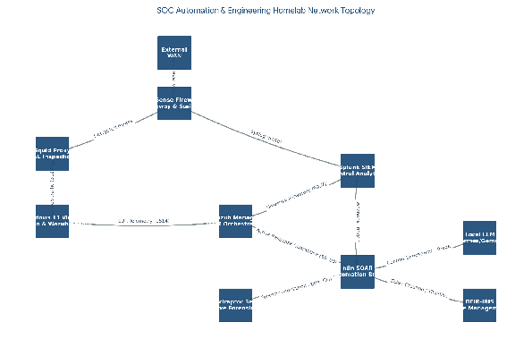

**Ref 2.** Consolidated homelab architecture connecting perimeter inspection, telemetry, SIEM, and response services.

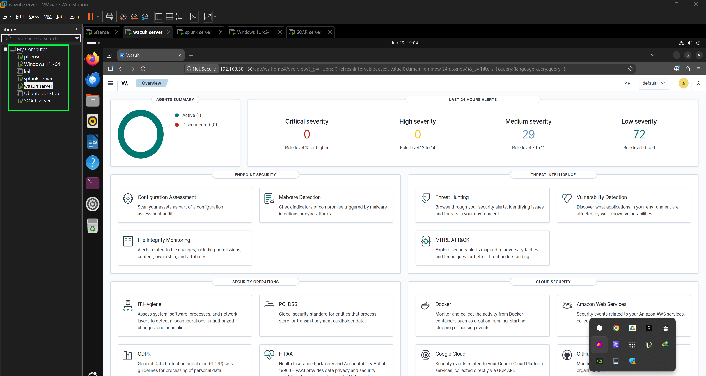

### 2. Perimeter and endpoint instrumentation

**Ref 3.** `pfSense` perimeter configuration supporting LAN control, proxy routing, and inspection.

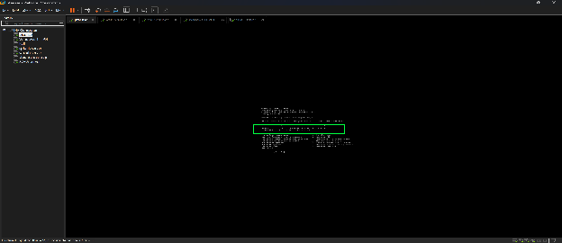

**Ref 4.** Windows 11 endpoint prepared with `Sysmon`, `Splunk Universal Forwarder`, and `Wazuh Agent`.

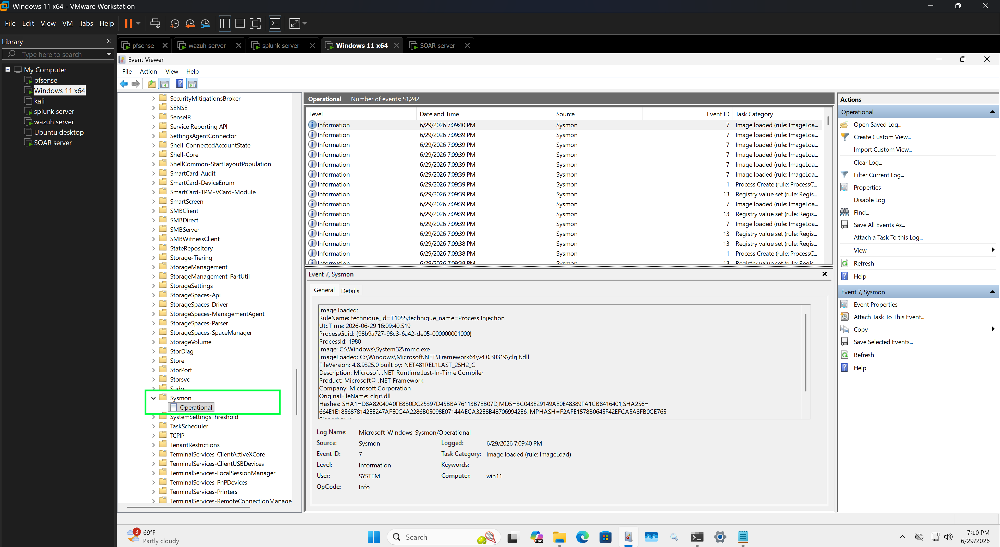

**Ref 5.** Additional endpoint evidence showing the installed monitoring stack used during workflow validation.

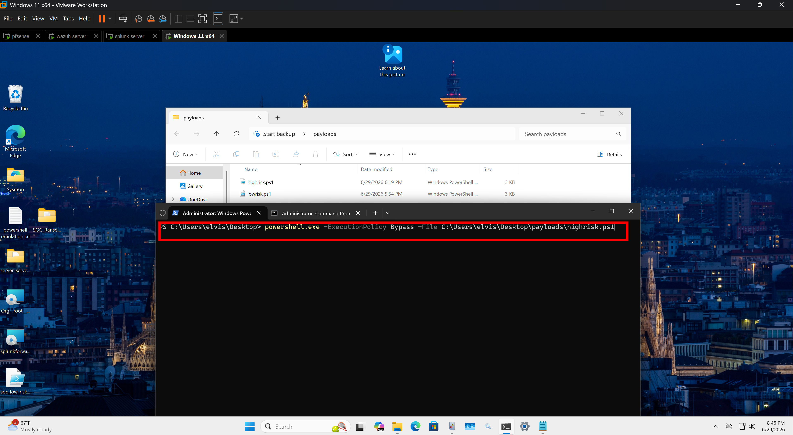

### 3. Splunk detection and correlation

**Ref 6.** Splunk evidence view used to validate the alerting and correlation stage before handing off to SOAR.

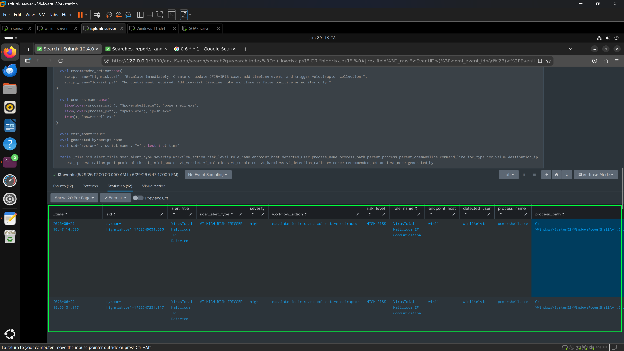

### 4. Wazuh telemetry and active response

**Ref 7.** Wazuh alert forwarding into the centralized workflow.

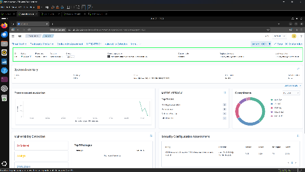

**Ref 8.** Wazuh active response enforcing host isolation through a firewall rule.

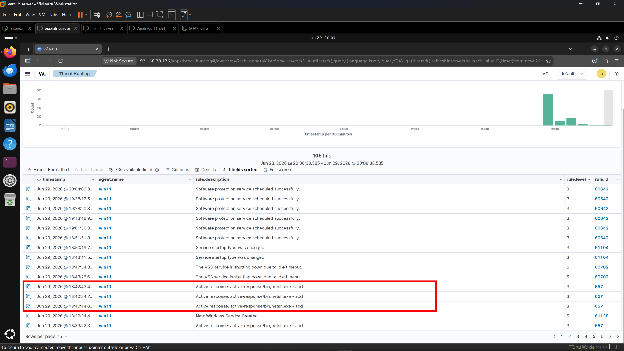

### 5. SOAR orchestration and case handling

**Ref 9.** `n8n` workflow receiving Splunk alerts and orchestrating the response chain.

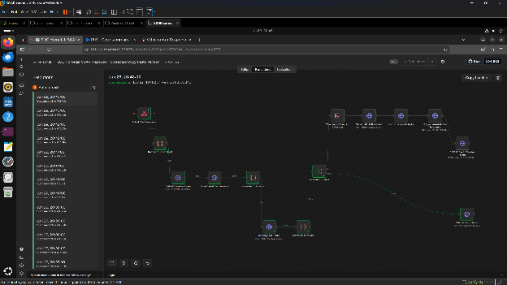

**Ref 10.** `n8n` branching logic for enrichment, triage, case updates, and automated follow-on actions.

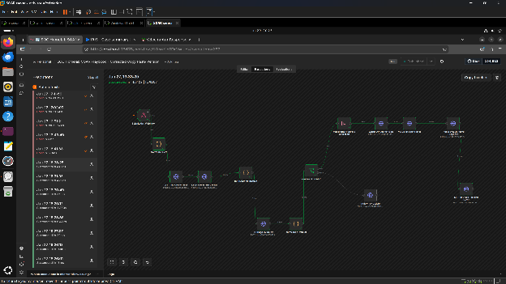

**Ref 11.** `DFIR-IRIS` investigation case created and updated for each alert.

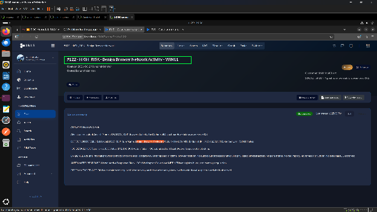

### 6. Forensic collection

**Ref 12.** `Velociraptor` forensic collection execution for the affected host.

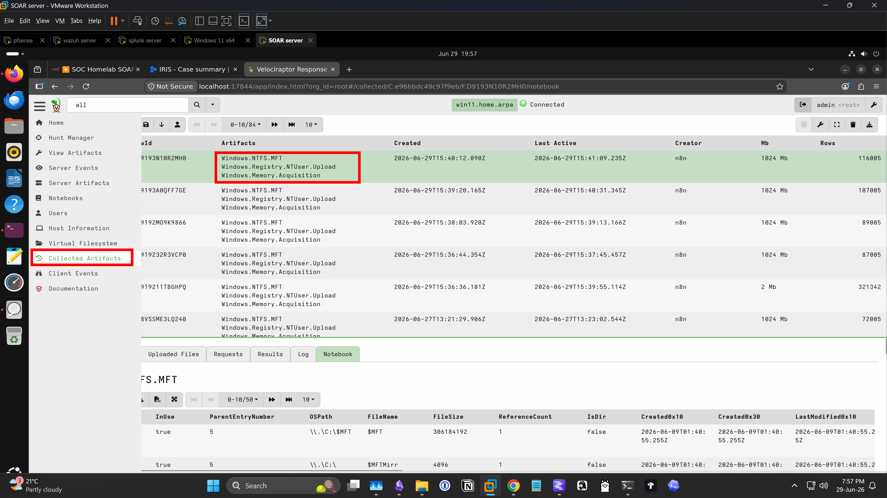

**Ref 13.** Master File Table artifact collection captured during the response workflow.

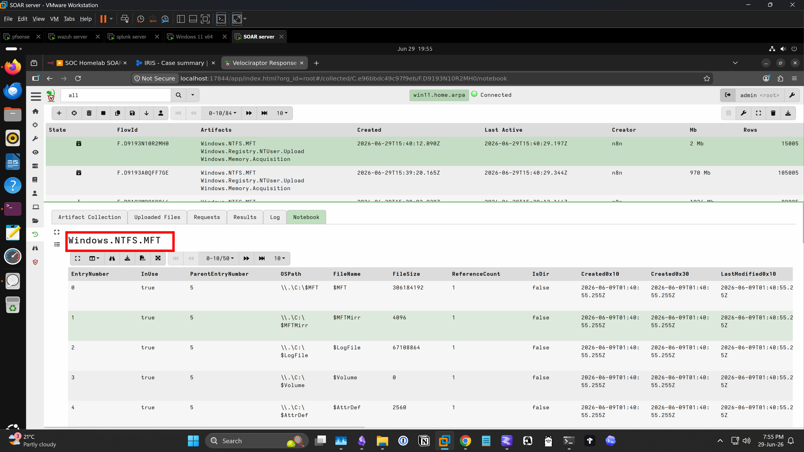

**Ref 14.** Windows Registry artifact collection preserved as part of automated triage.

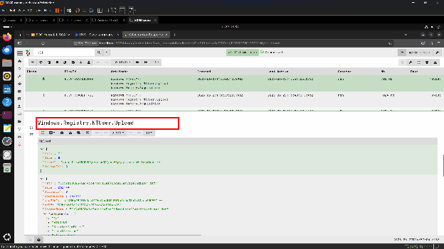

## MITRE ATT&CK Mapping
The validation scenarios documented here are synthetic: a "simulated malicious IOC event" (high-risk path) and a benign browser/gateway event (low-risk path). The write-up does not yet say which adversary technique the high-risk IOC represents, so no technique is claimed below until the author confirms it.

| Scenario | Technique | ID | Detection source | Response evidence |
|---|---|---|---|---|
| High-risk simulated IOC event (`highrisk.ps1` via `powershell.exe`, VirusTotal-flagged IP communication) | TBD by author | TBD by author | Splunk correlation search (Ref 6), Wazuh alert (Ref 7) | Velociraptor collection (Refs 12-14), Wazuh host isolation (Ref 8), DFIR-IRIS case (Ref 11) |
| Low-risk browser/gateway event | N/A (benign) | N/A | Splunk correlation search (Ref 6) | Documented and closed (flow step 7) |

## Detection & Response Logic
> **Reconstructed summary, not the original configuration.** The original SPL, n8n workflow export and Wazuh rules are no longer available. This section was reconstructed from the README and the screenshots referenced below. It describes behaviour only; it does not reproduce exact query or rule syntax.

### 1. Trigger (Splunk, Ref 6)
Sysmon events from the Windows 11 endpoint (`win11`, user `win11\elvis`) are indexed in Splunk. A search picks out events generated by the two synthetic test scripts, `highrisk.ps1` and `lowrisk.ps1`, both run through `powershell.exe`. It extracts fields such as process path, parent process, command line, destination IP/port and VirusTotal verdict counts, and builds a normalized alert. For the high-risk script, the alert carries:
- alert title "VirusTotal Malicious IP Detected" / rule "VirusTotal Malicious IP Communication"
- severity `high`, risk level `HIGH_RISK`, SOAR alert type `VT_HIGH_RISK_TRIGGER`
- workflow action `escalate_to_iris_and_collect_velociraptor`

The low-risk script maps to "No containment required. Add low-risk timeline note and close as false positive or monitor only." The alert is sent to n8n by webhook.

### 2. Case creation and enrichment (n8n and DFIR-IRIS, Refs 9-11)
In n8n, the **Splunk Alert Webhook** node passes the alert to **Normalize Alert**, then **DFIR-IRIS Create Ticket** opens a case. Next, a **Threat Intel Lookup** node enriches the indicator. The architecture diagram (Ref 1) describes this as VirusTotal reputation lookup. The workflow screenshot (Ref 10) labels the node "MISP Threat Intel Lookup". TODO (author): confirm which source the final workflow used.

### 3. LLM verdict (Refs 1, 10)
The enriched alert is normalized into a prompt for a local model (**AI Triage LM Studio** node, a low-temperature prompt per Ref 1). The response is normalized to a single verdict, `HIGH_RISK` or `LOW_RISK`, and **evaluate AI verdict** branches on it.

### 4. Response
- **HIGH_RISK:** **Velociraptor Forensic Collection** runs a triage collection on the host, with Master File Table and registry artifacts preserved (Refs 12-14). n8n then authenticates to the Wazuh API, looks up the agent by IP, and triggers **Wazuh Active Response**, which isolates the endpoint with a firewall rule (Ref 8). Finally, **DFIR-IRIS Add Timeline Event** records the actions on the case.
- **LOW_RISK:** an **IRIS low risk update** records the outcome, and the case is documented and closed (flow step 7).

### Pseudo-flow
```text
Sysmon event (win11, powershell.exe running highrisk.ps1 / lowrisk.ps1)
  -> Splunk search builds normalized alert (severity, risk_level, workflow_action, VT fields)
  -> webhook -> n8n: Normalize Alert
  -> DFIR-IRIS: create case
  -> Threat intel lookup (VirusTotal / MISP, see TODO)
  -> Local LLM (LM Studio): verdict = HIGH_RISK | LOW_RISK
  -> if HIGH_RISK:
        Velociraptor triage collection (MFT, registry)
        Wazuh API auth -> find agent by IP -> Active Response host isolation
        DFIR-IRIS: add timeline event
     else:
        DFIR-IRIS: low-risk update, document and close
```

## GitHub Pages

This site is designed to be published from the `/docs` folder on the `main` branch.

## Notes

- This is a controlled homelab for defensive engineering and portfolio documentation.
- Any IPs, alerts, and containment actions shown here were used for lab validation.
- The write-up is intentionally evidence-heavy so it works well both on GitHub and on GitHub Pages.
